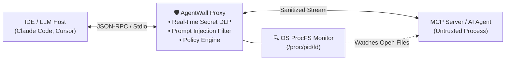

<div align="center">

# 🛡️ AgentWall

**Zero-Dependency Runtime Firewall, Secret DLP & Process Sandbox for AI Agents and MCP Servers**

[](https://github.com/barbarkaragul-oss/agentwall/actions)
[](https://github.com/barbarkaragul-oss/agentwall/releases)
[](#)
[](LICENSE)

*Stop autonomous AI agents (Claude Code, Cursor, OpenClaw, MCP Servers) from leaking your .env secrets, reading ~/.ssh/id_rsa, executing 
m -rf /, or falling for Indirect Prompt Injections.*

</div>

---

## 🚀 One-Line Quick Install

```bash
curl -fsSL https://raw.githubusercontent.com/barbarkaragul-oss/agentwall/main/install.sh | sh
```

Or build from source with **zero external dependencies**:
```bash
git clone https://github.com/barbarkaragul-oss/agentwall.git
cd agentwall
go build -ldflags="-s -w" -o bin/agentwall ./cmd/agentwall
```

---

## 🖥️ Real-Time Terminal UI Dashboard (gentwall ui)

Launch the built-in interactive telemetry monitor to inspect JSON-RPC packets, microsecond filter latency, and blocked exfiltration attempts in real time:

```text
╔════════════════════════════════════════════════════════════════════════════╗
║ 🛡️  AGENTWALL v1.1.0 — REAL-TIME AI AGENT & MCP SECURITY DASHBOARD         ║
╠════════════════════════════════════════════════════════════════════════════╣
║ PACKETS INSPECTED: 6        │ THREATS BLOCKED: 3      │ SECRETS MASKED: 2  ║
║ AVG FILTER LATENCY: 21 µs   │ SANDBOX STATUS:  ACTIVE │ PROCFS WATCHER: ON ║
╠════════════════════════════════════════════════════════════════════════════╣
║ TIME     │ ACTION   │ SEVERITY │ LATENCY │ EVENT DETAIL                    ║
╟──────────┼──────────┼──────────┼─────────┼─────────────────────────────────╢
║ 22:35:01 │ ALLOWED  │ CLEAN    │ 12 µs   │ Verified JSON-RPC packet        ║
║ 22:35:01 │ REDACTED │ HIGH     │ 19 µs   │ AWS_ACCESS_KEY masked           ║
║ 22:35:02 │ BLOCKED  │ CRITICAL │ 26 µs   │ SENSITIVE_PATH (.ssh/id_rsa)    ║
║ 22:35:02 │ BLOCKED  │ HIGH     │ 33 µs   │ INDIRECT_PROMPT_INJECTION       ║
║ 22:35:03 │ REDACTED │ HIGH     │ 40 µs   │ GITHUB_PAT masked               ║
║ 22:35:03 │ BLOCKED  │ CRITICAL │ 18 µs   │ DESTRUCTIVE_CMD (rm -rf /)      ║
╚════════════════════════════════════════════════════════════════════════════╝
```

---

## 🏗️ Architecture



---

## 🔌 Drop-In MCP Server Integration

Add gentwall wrap -- in front of any untrusted MCP server inside claude_desktop_config.json or .cursor/mcp.json:

```json
{
  "mcpServers": {
    "filesystem": {
      "command": "agentwall",
      "args": ["wrap", "--", "npx", "-y", "@modelcontextprotocol/server-filesystem", "."]
    }
  }
}
```

## 📄 License
MIT License — Copyright (c) 2026 Barbaros Karagulmez (arbarkaragul-oss)