# :shield: AgentWall

**Zero-Dependency Runtime Firewall, Secret DLP & Process Sandbox for AI Agents and MCP Servers**

*Stop autonomous AI agents (Claude Code, Cursor, OpenClaw, MCP Servers) from leaking your `.env` secrets, reading `~/.ssh/id_rsa`, executing `rm -rf /`, or falling for Indirect Prompt Injections.*

 

---

## :zap: Why AgentWall?

Developers are giving autonomous AI agents and third-party **Model Context Protocol (MCP)** servers full access to their local machines. A single hallucination or malicious prompt hidden inside a webpage or repository can cause an agent to:

1. **Exfiltrate Secrets:** Leak `AWS_ACCESS_KEY_ID`, GitHub PATs (`ghp_`), Slack tokens, or OpenAI (`sk-`) keys into external LLM context windows.
2. **Access Sensitive Files:** Silently read `~/.ssh/id_rsa`, `~/.aws/credentials`, `~/.kube/config`, or `/etc/shadow`.
3. **Execute Destructive Commands:** Run `rm -rf /`, reverse shells, or unauthorized network calls.

**AgentWall** wraps any CLI agent or MCP server with a **single zero-dependency Go binary** and inspects `stdio` (JSON-RPC 2.0) traffic and OS-level process file descriptors in `< 20 microseconds`.

---

## :rocket: One-Line Quick Install

**Linux & macOS:**
~~~bash
curl -fsSL https://raw.githubusercontent.com/barbarkaragul-oss/agentwall/main/install.sh | sh
~~~

**Windows (PowerShell):**
~~~powershell
irm https://raw.githubusercontent.com/barbarkaragul-oss/agentwall/main/install.ps1 | iex
~~~

**Build from Source (Zero External Dependencies):**
~~~bash
git clone https://github.com/barbarkaragul-oss/agentwall.git
cd agentwall
go build -ldflags="-s -w" -o bin/agentwall ./cmd/agentwall
~~~

---

## :desktop_computer: CLI Commands & Real-Time TUI (`agentwall ui`)

~~~bash
# 1. Launch the interactive real-time TUI security telemetry dashboard
agentwall ui

# 2. Run the live 4-scenario attack interception simulation
agentwall demo

# 3. Run the 50,000-packet microsecond throughput benchmark
agentwall bench

# 4. Scan any local directory or repo for leaked secrets & prompt injections
agentwall scan .
~~~

### Real-Time Telemetry Output
~~~text
+----------------------------------------------------------------------------+
| AGENTWALL v1.1.0 -- REAL-TIME AI AGENT & MCP SECURITY DASHBOARD            |
+----------------------------------------------------------------------------+
| PACKETS INSPECTED: 6        | THREATS BLOCKED: 3      | SECRETS MASKED: 2  |
| AVG FILTER LATENCY: 18 us   | SANDBOX STATUS:  ACTIVE | PROCFS WATCHER: ON |
+----------------------------------------------------------------------------+
| TIME     | ACTION   | SEVERITY | LATENCY | EVENT DETAIL                    |
+----------+----------+----------+---------+---------------------------------+
| 22:40:01 | ALLOWED  | CLEAN    | 12 us   | Verified JSON-RPC packet        |
| 22:40:02 | REDACTED | HIGH     | 19 us   | AWS_ACCESS_KEY masked           |
| 22:40:03 | BLOCKED  | CRITICAL | 15 us   | SENSITIVE_PATH (.ssh/id_rsa)    |
| 22:40:04 | BLOCKED  | HIGH     | 17 us   | INDIRECT_PROMPT_INJECTION       |
| 22:40:05 | REDACTED | HIGH     | 14 us   | GITHUB_PAT masked               |
| 22:40:06 | BLOCKED  | CRITICAL | 11 us   | DESTRUCTIVE_CMD (rm -rf /)      |
+----------------------------------------------------------------------------+
~~~

---

## :building_construction: Architecture

~~~mermaid
flowchart LR
    Host["IDE / LLM Host\n(Claude Code, Cursor)"] <-->|JSON-RPC / Stdio| AW["AgentWall Proxy\n* Real-time Secret DLP\n* Prompt Injection Filter\n* Policy Engine"]
    AW <-->|Sanitized Stream| Agent["MCP Server / AI Agent\n(Untrusted Process)"]
    ProcMon["OS ProcFS & Socket Monitor\n(/proc/pid/fd & /proc/pid/net/tcp)"] -.->|Watches Files & Sockets| Agent
    AW --- ProcMon
~~~

---

## Native MCP inspection server

Run `agentwall serve` (or its alias `agentwall mcp`) to expose the
`inspect_payload` tool over stdio. This mode runs locally without API keys,
network access, or configuration files. Stdout contains only newline-delimited
JSON-RPC; diagnostics go to stderr.

~~~json
{
  "mcpServers": {
    "agentwall": {
      "command": "/absolute/path/to/agentwall",
      "args": ["serve"]
    }
  }
}
~~~

The tool takes `{"payload":"text to inspect"}` and returns a text content block
containing JSON with `sanitized`, `secrets`, and `violations`. Matched secret
patterns are redacted. Default-policy matches, including sensitive paths and
prompt-injection phrases, are counted but remain in the returned text. Inspection
is pattern-based and is not a guarantee that arbitrary text is safe. The tool
never executes the payload, reads local files, or starts a child process.

This stdio server negotiates the handshake-based MCP versions `2024-11-05`,
`2025-03-26`, `2025-06-18`, and `2025-11-25`. Unsupported requested versions
receive `2025-11-25` as a counter-offer. Send `notifications/initialized` after
`initialize`, then use `tools/list` and `tools/call`. It does not implement
Streamable HTTP or the `2026-07-28` stateless protocol.

### Container and protocol checks

~~~bash
docker build -t agentwall-mcp .
# Keep stdin open; do not allocate a TTY for MCP stdio.
docker run --rm -i --network none agentwall-mcp

# Reproducible lifecycle, discovery, invocation and error-handling checks:
go test -race ./...
go build -o bin/agentwall ./cmd/agentwall
python3 scripts/check_mcp_stdio.py ./bin/agentwall serve
python3 scripts/check_mcp_stdio.py ./bin/agentwall mcp
python3 scripts/check_mcp_stdio.py docker run --rm -i --network none agentwall-mcp
~~~

The Dockerfile starts this native server with `agentwall serve`. To obtain a
Glama evaluation, submit this repository in Glama, claim it with the maintainer
listed in `glama.json`, and add the repository's Dockerfile directly to the Glama
build configuration. Verify a successful build, tool discovery, and the resulting
quality score on the actual listing. A badge URL or a successful local test does
not establish that Glama has evaluated the server.

---

## :electric_plug: Drop-In MCP Server Integration

Add `agentwall wrap --` in front of any untrusted MCP server inside `claude_desktop_config.json` or `.cursor/mcp.json`:

~~~json
{
  "mcpServers": {
    "filesystem": {
      "command": "agentwall",
      "args": ["wrap", "--", "npx", "-y", "@modelcontextprotocol/server-filesystem", "."]
    }
  }
}
~~~

---

## :page_facing_up:License

MIT License - Copyright (c) 2026 Barbaros Karagulmez (barbarkaragul-oss)
