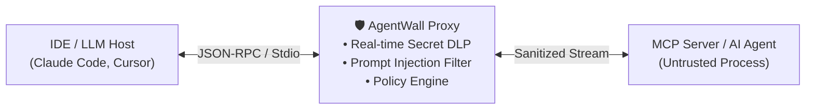

<div align="center">

# 🛡️ AgentWall

**Zero-Dependency Runtime Firewall, Secret DLP & Process Sandbox for AI Agents and MCP Servers**

[](#)
[](#)
[](LICENSE)

*Stop autonomous AI agents (Claude Code, Cursor, OpenClaw, MCP Servers) from leaking your .env secrets, reading ~/.ssh/id_rsa, executing rm -rf /, or falling for Indirect Prompt Injections.*

</div>

---

## ⚡ Why AgentWall?

Developers are giving autonomous AI agents and third-party **Model Context Protocol (MCP)** servers full access to their local machines. A single hallucination or malicious prompt hidden inside a webpage/repo can cause an agent to:
1. Exfiltrate AWS_ACCESS_KEY_ID, GitHub PATs, or OpenAI API keys to external servers.
2. Read ~/.ssh/id_rsa or ~/.kube/config silently in the background.
3. Execute destructive shell commands (rm -rf, reverse shells).

**AgentWall** wraps any CLI agent or MCP server with a **single zero-dependency Go binary** and inspects stdio (JSON-RPC 2.0) traffic in microseconds.

---

## 🏗️ Architecture



---

## 🚀 Quick Start

```ash
git clone [https://github.com/barbarkaragul-oss/agentwall.git](https://github.com/barbarkaragul-oss/agentwall.git)
cd agentwall
go build -o bin/agentwall ./cmd/agentwall
./bin/agentwall demo
```

### Wrap Any MCP Server (claude_desktop_config.json / .cursor/mcp.json)
```json
{
  "mcpServers": {
    "filesystem": {
      "command": "agentwall",
      "args": ["wrap", "--", "npx", "-y", "@modelcontextprotocol/server-filesystem", "."]
    }
  }
}
```

## 📄 License
MIT License