# :shield: AgentWall

**Zero-Dependency Runtime Firewall, Secret DLP & Process Sandbox for AI Agents and MCP Servers**

*Stop autonomous AI agents (Claude Code, Cursor, OpenClaw, MCP Servers) from leaking your `.env` secrets, reading `~/.ssh/id_rsa`, executing `rm -rf /`, or falling for Indirect Prompt Injections.*

 

---

## :zap: Why AgentWall?

Developers are giving autonomous AI agents and third-party **Model Context Protocol (MCP)** servers full access to their local machines. A single hallucination or malicious prompt hidden inside a webpage or repository can cause an agent to:

1. **Exfiltrate Secrets:** Leak `AWS_ACCESS_KEY_ID`, GitHub PATs (`ghp_`), Slack tokens, or OpenAI (`sk-`) keys into external LLM context windows.
2. **Access Sensitive Files:** Silently read `~/.ssh/id_rsa`, `~/.aws/credentials`, `~/.kube/config`, or `/etc/shadow`.
3. **Execute Destructive Commands:** Run `rm -rf /`, reverse shells, or unauthorized network calls.

**AgentWall** wraps any CLI agent or MCP server with a **single zero-dependency Go binary** and inspects `stdio` (JSON-RPC 2.0) traffic and OS-level process file descriptors in `< 20 microseconds`.

---

## :rocket: One-Line Quick Install

**Linux & macOS:**
~~~bash
curl -fsSL https://raw.githubusercontent.com/barbarkaragul-oss/agentwall/main/install.sh | sh
~~~

**Windows (PowerShell):**
~~~powershell
irm https://raw.githubusercontent.com/barbarkaragul-oss/agentwall/main/install.ps1 | iex
~~~

**Build from Source (Zero External Dependencies):**
~~~bash
git clone https://github.com/barbarkaragul-oss/agentwall.git
cd agentwall
go build -ldflags="-s -w" -o bin/agentwall ./cmd/agentwall
~~~

---

## :desktop_computer: CLI Commands & Real-Time TUI (`agentwall ui`)

~~~bash
# 1. Launch the interactive real-time TUI security telemetry dashboard
agentwall ui

# 2. Run the live 4-scenario attack interception simulation
agentwall demo

# 3. Run the 50,000-packet microsecond throughput benchmark
agentwall bench

# 4. Scan any local directory or repo for leaked secrets & prompt injections
agentwall scan .
~~~

### Real-Time Telemetry Output
~~~text
+----------------------------------------------------------------------------+
| AGENTWALL v1.1.0 -- REAL-TIME AI AGENT & MCP SECURITY DASHBOARD            |
+----------------------------------------------------------------------------+
| PACKETS INSPECTED: 6        | THREATS BLOCKED: 3      | SECRETS MASKED: 2  |
| AVG FILTER LATENCY: 18 us   | SANDBOX STATUS:  ACTIVE | PROCFS WATCHER: ON |
+----------------------------------------------------------------------------+
| TIME     | ACTION   | SEVERITY | LATENCY | EVENT DETAIL                    |
+----------+----------+----------+---------+---------------------------------+
| 22:40:01 | ALLOWED  | CLEAN    | 12 us   | Verified JSON-RPC packet        |
| 22:40:02 | REDACTED | HIGH     | 19 us   | AWS_ACCESS_KEY masked           |
| 22:40:03 | BLOCKED  | CRITICAL | 15 us   | SENSITIVE_PATH (.ssh/id_rsa)    |
| 22:40:04 | BLOCKED  | HIGH     | 17 us   | INDIRECT_PROMPT_INJECTION       |
| 22:40:05 | REDACTED | HIGH     | 14 us   | GITHUB_PAT masked               |
| 22:40:06 | BLOCKED  | CRITICAL | 11 us   | DESTRUCTIVE_CMD (rm -rf /)      |
+----------------------------------------------------------------------------+
~~~

---

## :building_construction: Architecture

~~~mermaid
flowchart LR
    Host["IDE / LLM Host\n(Claude Code, Cursor)"] <-->|JSON-RPC / Stdio| AW["AgentWall Proxy\n* Real-time Secret DLP\n* Prompt Injection Filter\n* Policy Engine"]
    AW <-->|Sanitized Stream| Agent["MCP Server / AI Agent\n(Untrusted Process)"]
    ProcMon["OS ProcFS & Socket Monitor\n(/proc/pid/fd & /proc/pid/net/tcp)"] -.->|Watches Files & Sockets| Agent
    AW --- ProcMon
~~~

---

## :electric_plug: Drop-In MCP Server Integration

Add `agentwall wrap --` in front of any untrusted MCP server inside `claude_desktop_config.json` or `.cursor/mcp.json`:

~~~json
{
  "mcpServers": {
    "filesystem": {
      "command": "agentwall",
      "args": ["wrap", "--", "npx", "-y", "@modelcontextprotocol/server-filesystem", "."]
    }
  }
}
~~~

---

## :page_facing_up:License

MIT License - Copyright (c) 2026 Barbaros Karagulmez (barbarkaragul-oss)